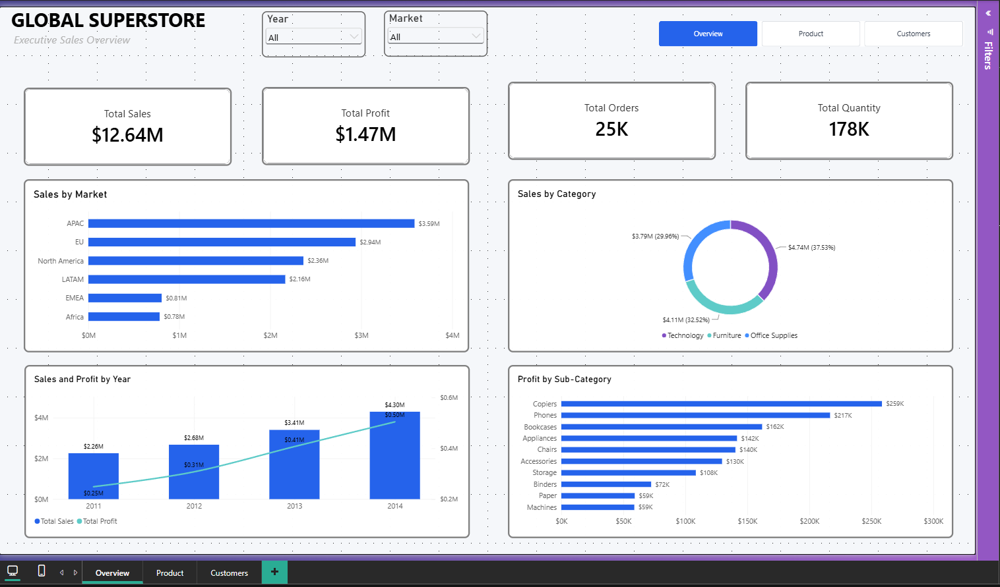
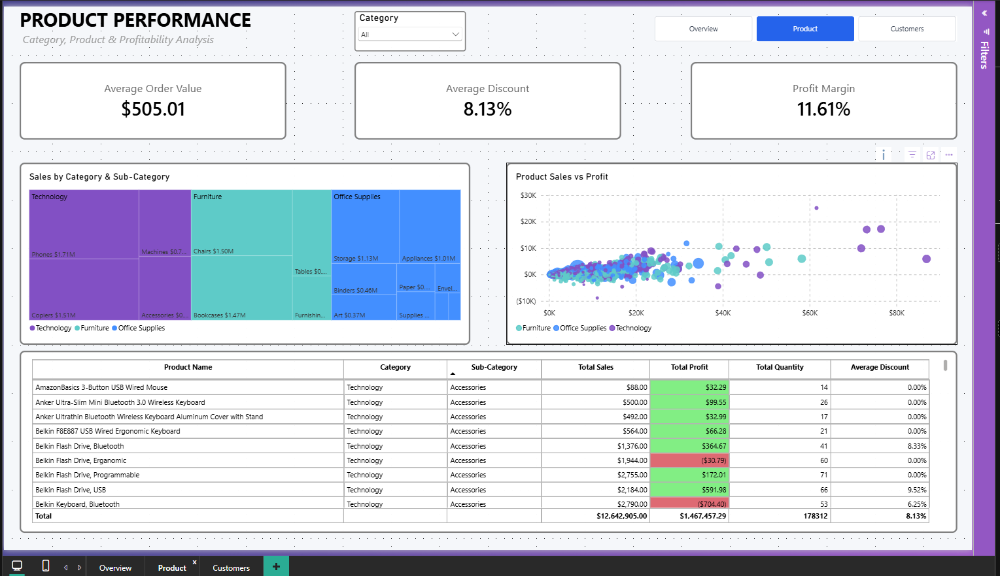
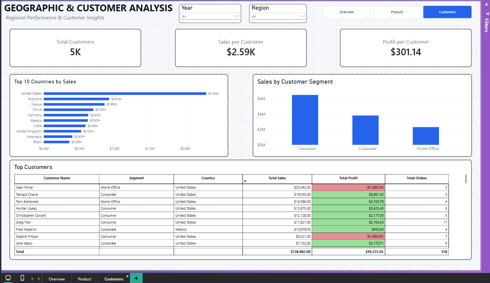

# Global Superstore Sales & Profit Dashboard

### Power BI | DAX | Data Analytics | Business Intelligence

An interactive three-page Power BI dashboard analyzing global retail sales, profitability, product performance, and customer behavior from 2011 to 2014.

The project demonstrates how raw retail transactions can be transformed into meaningful KPIs and interactive reports to support business performance analysis.

## Project Overview

**Dataset:** Global Superstore  
**Tool:** Microsoft Power BI Desktop  
**Analysis Period:** 2011–2014  
**Focus:** Sales Performance, Product Profitability, Geographic Trends, Customer Analysis

## Business Objectives

- Evaluate overall sales growth and profitability across markets and years.
- Identify top-performing markets, product categories, and subcategories.
- Examine the relationship between product sales and profit.
- Analyze revenue contribution across countries and customer segments.
- Create interactive reports that allow users to explore retail performance.

## Dashboard Overview

### 1. Executive Sales Overview



The executive dashboard provides a high-level view of sales, profitability, and business performance.

**Key Performance Indicators**

| Metric | Value |
|---|---:|
| Total Sales | $12.64M |
| Total Profit | $1.47M |
| Total Orders | 25K |
| Total Quantity | 178K |

**Key Insights**

- APAC leads market-level sales with approximately **$3.59M**, followed by EU at **$2.94M**.
- Technology is the highest-selling category, contributing approximately **$4.74M (37.53%)** of total sales.
- Annual sales increased from **$2.26M in 2011** to **$4.30M in 2014**.
- Copiers generated approximately **$259K in profit**, ranking first among the displayed subcategories.

**Visualizations:** KPI cards, market comparison bar chart, category donut chart, annual sales/profit combination chart, and subcategory profit ranking.

### 2. Product Performance Analysis



The product dashboard explores sales distribution, profitability, and discounts across retail products.

**Key Performance Indicators**

| Metric | Value |
|---|---:|
| Average Order Value | $505.01 |
| Average Discount | 8.13% |
| Profit Margin | 11.61% |

**Key Insights**

- Phones generated approximately **$1.71M in sales**, making them one of the leading subcategories.
- The product-level sales-versus-profit scatter chart reveals considerable variation in profitability.
- Some products exhibit negative profit despite generating sales, highlighting potential areas for further discount and cost analysis.

**Visualizations:** Category/subcategory treemap, sales-versus-profit scatter chart, detailed product table, conditional formatting, and category slicer.

### 3. Geographic & Customer Analysis



This dashboard examines geographic revenue distribution and customer performance.

**Key Performance Indicators**

| Metric | Value |
|---|---:|
| Total Customers | Approximately 5K |
| Sales per Customer | $2.59K |
| Profit per Customer | $301.14 |

**Key Insights**

- The United States leads the displayed country rankings with approximately **$2.30M in sales**.
- Australia and France follow with approximately **$0.93M** and **$0.86M** respectively.
- The Consumer segment contributes the largest share of sales, followed by Corporate and Home Office.
- The customer-level table helps identify highly profitable customers as well as customers associated with losses.

**Visualizations:** Top 10 countries bar chart, customer segment sales chart, detailed customer performance table, and year/region slicers.

## Dashboard Features

- Three interconnected analytical report pages
- KPI reporting using DAX measures
- Interactive slicers for year, market, region, and category
- Page navigation buttons
- Sales and profit comparisons
- Product and customer-level performance tables
- Conditional formatting to distinguish positive and negative profitability
- Interactive chart filtering and contextual analysis

## Skills Demonstrated

| Category | Technologies & Techniques |
|---|---|
| Business Intelligence | Microsoft Power BI |
| Calculations | DAX, KPI Measures |
| Analytics | Sales Analysis, Profitability Analysis, Customer Segmentation |
| Visualization | KPI Cards, Bar Charts, Treemaps, Scatter Charts, Donut Charts |
| Reporting | Interactive Filters, Drill-down, Conditional Formatting |
| Decision Support | Performance Monitoring, Product and Market Comparisons |

## Key Business Takeaways

The analysis indicates that sales and profitability vary considerably by market, product category, and customer segment.

Technology contributes the largest share of sales, while individual product profitability varies even among high-selling products.

The dashboard can help analysts investigate revenue concentration, customer profitability, and opportunities for deeper operational analysis. These are analytical findings, not claims of implemented business improvements.

## Repository Structure

```text
Global-Superstore-Dashboard/
├── README.md
├── Superstoredata-dashboard.pbix
└── screenshots/
    ├── 01-Overview.png
    ├── 02-Product.png
    └── 03-Customers.png
```

## How to Use

1. Clone or download this GitHub repository.
2. Install Microsoft Power BI Desktop.
3. Open `Superstoredata-dashboard.pbix`.
4. Explore the Overview, Product, and Customers report pages.
5. Apply slicers and interact with visuals to analyze specific segments.

## Author

**Hrudayesh Gharat**  
Data Analyst | SQL | Python | Power BI | Excel

[GitHub](https://github.com/hrudayeshgharat/) | [LinkedIn](https://www.linkedin.com/in/hrudayeshgharat/) | [Portfolio](https://hrudfolio.vercel.app/)